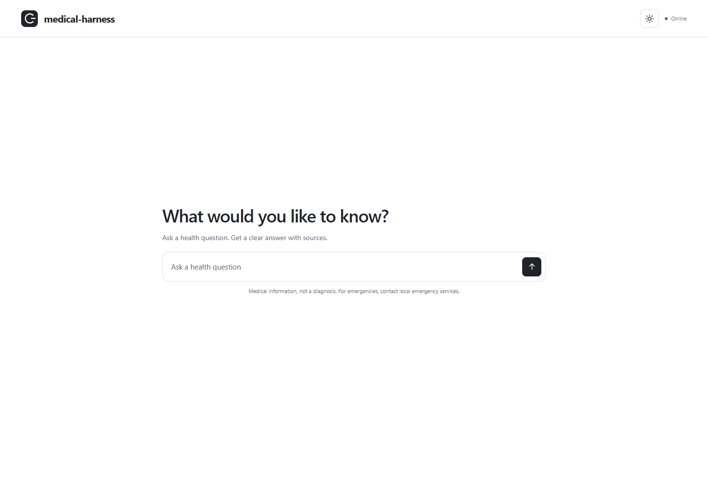
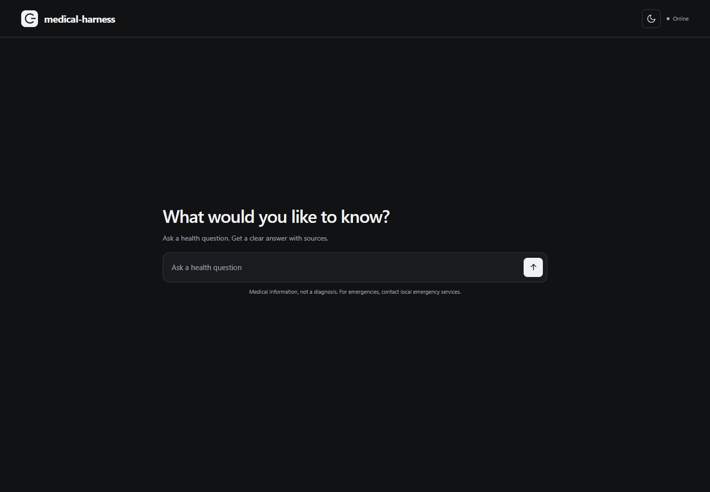
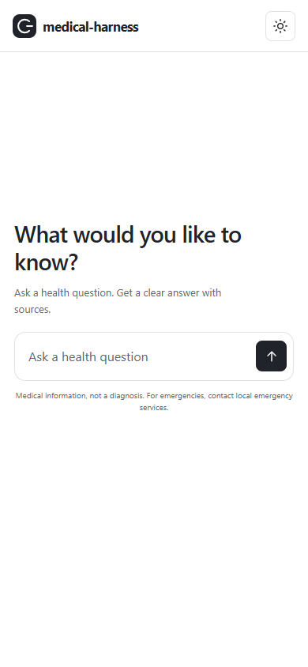
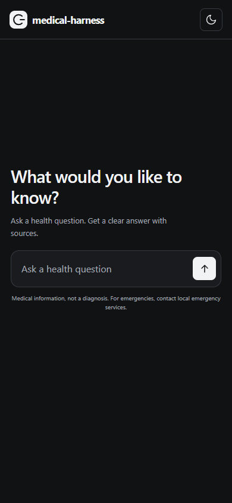
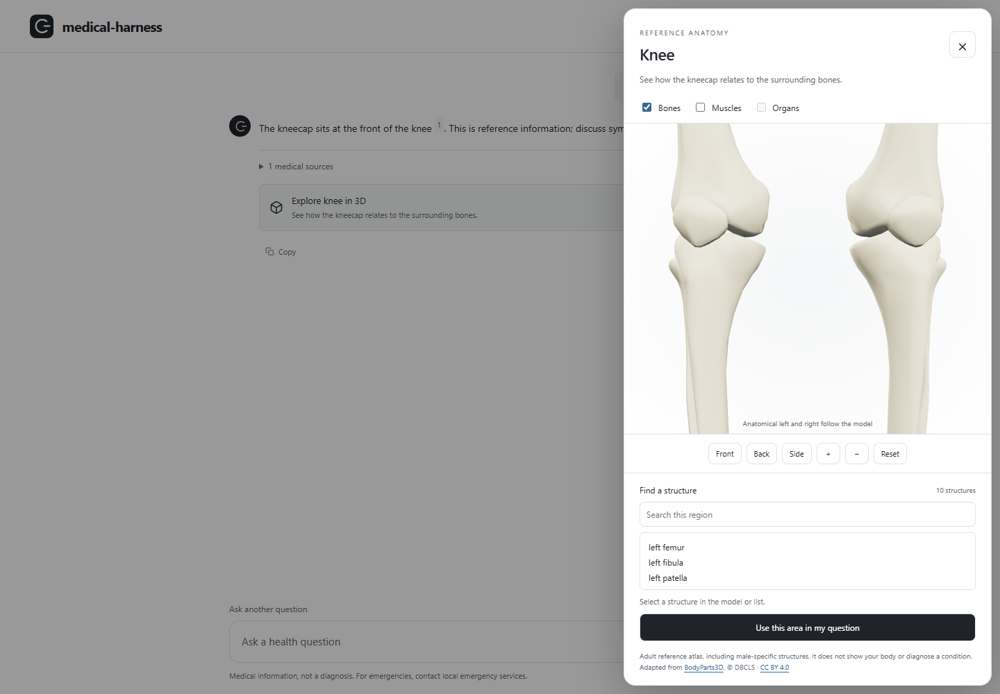
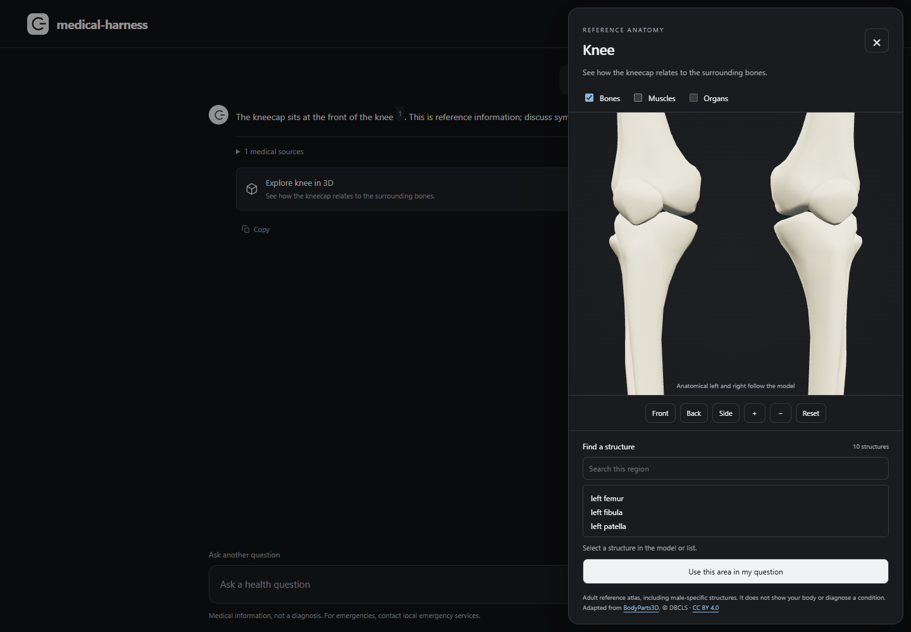
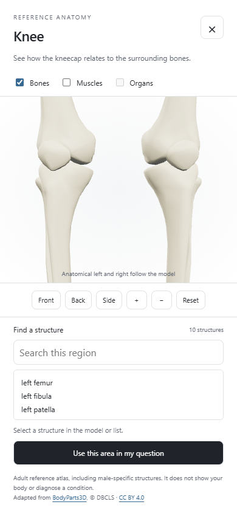
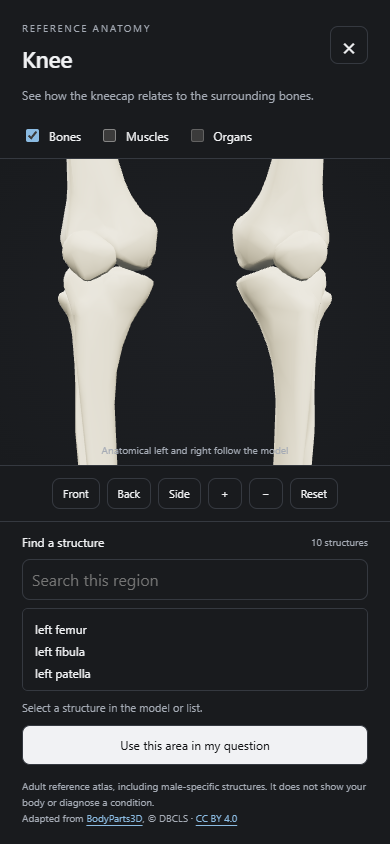

# Browser verification

Screenshots are generated from synthetic responses by `npm run test:browser`. Desktop is 1440 × 1000; mobile is 390 × 844. Both themes use reduced-motion mode. Startup tests delay the app module to verify the home screen is present before initialization and no anatomy code/assets are requested.

| View | Light | Dark |
| --- | --- | --- |
| Desktop home |  |  |
| Mobile home |  |  |
| Desktop anatomy |  |  |
| Mobile anatomy |  |  |

Tests also cover graphics failure with searchable fallback, older-answer context, new-question reset, and discarded unreviewed chunks. The outdated walkthrough recording was removed.
